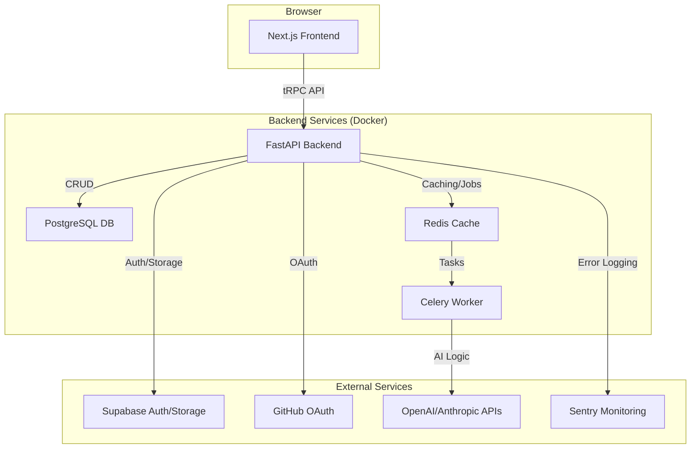

# Borg Tools - Your Personal AI-Powered Development OS

[](https://github.com/vizi2000/borg-tools-mvp/actions)
[](https://opensource.org/licenses/MIT)

**Borg Tools** is an integrated, full-stack environment for rapidly prototyping, building, and testing AI-powered web applications. It serves as a personal "Development OS", combining a modern frontend, a robust Python backend, and a suite of tools for AI agent management, testing, and deployment.

---

## 🏛️ Architecture Overview

The platform is built on a decoupled, service-oriented architecture, orchestrated with Docker.



---

## ✨ Key Features

- **Full-Stack Platform**: Modern, reactive frontend built with **Next.js & TypeScript**, powered by a high-performance **FastAPI** backend in Python.
- **AI Integration**: Deep integration with **LangChain**, **OpenAI**, and **Anthropic** for building complex, agentic workflows.
- **Asynchronous Background Jobs**: Utilizes **Celery** and **Redis** to handle long-running tasks like report generation or AI processing without blocking the UI.
- **Robust Authentication**: Secure JWT-based authentication, supplemented by **Supabase** and **GitHub OAuth** providers.
- **Production-Grade Database**: Uses **PostgreSQL** with **SQLAlchemy** for data persistence and **Alembic** for schema migrations.
- **Comprehensive Testing Suite**: Includes unit/integration tests with **Vitest** and E2E/visual regression tests with **Playwright**.
- **Professional Tooling**: Comes pre-configured with **Docker**, **Sentry** for monitoring, and a full suite of code quality tools (`ruff`, `mypy`, `prettier`).

---

## 🛠️ Tech Stack

| Area                  | Technologies                                                                                                                                 |
| --------------------- | -------------------------------------------------------------------------------------------------------------------------------------------- |
| **Frontend**          | `Next.js`, `React`, `TypeScript`, `TailwindCSS`, `tRPC`, `React Query`                                                                         |
| **Backend**           | `Python`, `FastAPI`, `SQLAlchemy`, `Pydantic`, `Celery`                                                                                        |
| **AI/ML**             | `LangChain`, `OpenAI API`, `Anthropic API`, `LangSmith`                                                                                        |
| **Database & Cache**  | `PostgreSQL`, `Redis`                                                                                                                        |
| **Infrastructure**    | `Docker`, `Docker Compose`, `Supabase`                                                                                                       |
| **Testing & QA**      | `Playwright`, `Vitest`, `Pytest`, `Ruff`, `Mypy`, `ESLint`, `Prettier`                                                                         |
| **Monitoring**        | `Sentry`, `Langfuse`                                                                                                                         |

---

## 🚀 Getting Started

This project is fully containerized, making setup straightforward.

### Prerequisites

- [Docker](https://www.docker.com/get-started/) & Docker Compose
- [pnpm](https://pnpm.io/installation)
- Git

### Installation & Setup

1.  **Clone the repository:**
    ```bash
    git clone https://github.com/vizi2000/borg-tools-mvp.git
    cd borg-tools-mvp
    ```

2.  **Configure environment variables:**
    - Create a `.env` file from the example: `cp .env.example .env`
    - Populate the `.env` file with your credentials for Supabase, GitHub, OpenAI, etc.

3.  **Build and launch the services:**
    ```bash
    docker-compose up --build -d
    ```
    This command will build the images and start the frontend, backend, database, and Redis containers in the background.

4.  **Install frontend dependencies (for local development & type checking):**
    ```bash
    pnpm install
    ```

5.  **Run database migrations:**
    ```bash
    docker-compose exec backend alembic upgrade head
    ```

Your application is now running! 
- Frontend is available at [http://localhost:3333](http://localhost:3333)
- Backend API docs are at [http://localhost:8000/docs](http://localhost:8000/docs)

---

## 🧪 Running Tests

- **Run all frontend tests:** `pnpm test:unit`
- **Run all backend tests:** `docker-compose exec backend pytest`
- **Run E2E tests:** `pnpm test`

---

## 📄 License

This project is licensed under the MIT License. See the [LICENSE](LICENSE) file for details.